# Counterpart

**Consensus-derived service compatibility, followed by provably maximum matching.**

Service exchanges often describe needs and offers in ordinary language: translate public API docs into Indonesian, copyedit an English tutorial, or provide technical review subject to a supplier's restrictions. Matching on shared words misses negation, omitted requirements and provider boundaries. Asking a model to pick the “best matches” gives it control over both the compatibility evidence and the allocation.

Counterpart separates those jobs. GenLayer validators independently derive the **complete two-way compatibility matrix**. The deterministic contract exhausts the bounded assignment space, selects maximum-cardinality matching with a specified tie-break, and creates one-to-one reservations. Both matched participants must confirm the immutable snapshot before a reservation becomes an agreement.

One standalone Intelligent Contract, no frontend and no backend oracle. See [source](contracts/counterpart.py), [consensus and optimizer](docs/CONSENSUS.md), [threat model](docs/SECURITY.md), [submission text](SUBMISSION.md), and [deployment evidence](deployment.json).

## The greedy trap

Suppose requester A needs translation, requester B needs copyediting. Supplier X offers both; supplier Y offers translation only.

| Compatibility | Supplier X | Supplier Y |
|---|---|---|
| A: translation | yes | yes |
| B: copyediting | yes | no |

A greedy A→X assignment leaves B unmatched. Counterpart computes A→Y and B→X, serving both. This choice is deterministic; an LLM cannot choose a favorite allocation or invent an extra capacity slot.

“I provide copyediting, **not translation**” does not fulfill a translation request. An otherwise suitable service with “public documents only” must also reject a task explicitly involving private documents. Every matrix cell includes both `fulfills` and `admissible`, and an exact confidence bucket. Only `YES / YES / high` creates an edge.

## Lifecycle and consent

```mermaid
stateDiagram-v2
    [*] --> COLLECTING
    COLLECTING --> CLEARED: deadline reached; anyone runs clear
    CLEARED --> CLOSED: confirmation deadline reached; anyone runs expire
    state CLEARED {
      [*] --> RESERVED
      RESERVED --> AGREED: both participants confirm snapshot hash
      RESERVED --> DECLINED: either participant declines
      RESERVED --> EXPIRED: deadline cleanup
    }
```



Participants opt into an immutable specification. During collection they may withdraw, but cannot replace their entry or move to the other side under the same address. After the collection deadline the input set is frozen. Withdrawn entries are excluded before matrix construction; compact matrix indices map back to original entry IDs in state.

Clearing and expiry are permissionless. The batch creator cannot alter specifications, remove competitors, approve a match for another address, or change an allocation. A decline does not silently rematch participants against a new snapshot. Start a new batch if new matching is wanted.

## Consensus and deterministic allocation

1. Every demand×supply pair is evaluated, including negative and apparently unrelated pairs. There is no textual similarity prefilter that could hide a plausible match.
2. Each validator re-evaluates all requirements and supplier restrictions from the same frozen input, without receiving the leader's answer in its evaluation prompt.
3. The complete normalized matrix must match exactly: pair indices, fulfillment, admissibility, and confidence. A `high`→`medium` change disagrees even if both are plausible buckets.
4. The contract constructs edges only from `YES / YES / high` cells. It maximizes matched demand count, then selects the lexicographically smallest supplier assignment. Unmatched uses a sentinel after all supplier IDs.
5. Matches become RESERVED, not irrevocable service commitments. Bilateral confirmation binds the exact input snapshot, including participants and specifications. Only a matched address can consent.

At most four demands and four supplies are accepted per batch. The complete 4×4 graph has 209 partial one-to-one matchings, so exhaustive allocation is practical and auditable. Each participant represents one slot **in that batch only**. There is no claim of verified global inventory or human identity.

## Public interface

| Method | Behavior |
|---|---|
| `open_batch(label, collection_seconds, confirmation_seconds)` | Create a bounded public batch; returns ID. |
| `join(batch_id, side, specification, restrictions)` | Opt in once per address; side is demand or supply. Supply restrictions are separate; demand requirements belong in its specification. |
| `withdraw(batch_id)` | Own entry only, before collection closes. |
| `clear(batch_id)` | Anyone after collection deadline; consensus matrix and deterministic allocation. |
| `confirm(batch_id, match_index, input_digest)` | Matched participant only, before confirmation deadline; both needed. |
| `decline(batch_id, match_index)` | Either matched participant, while reservation is live. |
| `expire(batch_id)` | Anyone after confirmation deadline; unresolved reservations become EXPIRED. |
| `get_batch`, `version` | Public views. |

Specifications are limited to 1,500 characters, supplier restrictions to 1,000, and each lifecycle window to 60 seconds–7 days. Transaction time controls the inclusive closing boundary. No payments or subjective ranking scores are involved.

## Reproduce

Python 3.12.10 or compatible Python 3.12, plus the GenLayer CLI:

```bash
python -m pip install -r requirements.txt
genvm-lint check contracts/counterpart.py --json
python -m pytest -q
genlayer network set studionet
genlayer deploy --contract contracts/counterpart.py
```

The contract pins the v0.2.12 runner. Tests execute captured validators with altered independent outputs. They cover missing/duplicate pairs, exact confidence, unilateral compatibility, negative-edge disagreements, ordering, bilateral consent, snapshot substitution, withdrawal, immutable clearing, decline, and expiry. An independent exhaustive reference checks **all 512 possible 3×3 compatibility graphs**, including tie-breaking and maximum cardinality.

[LIVE_VALIDATION.md](docs/LIVE_VALIDATION.md) reports real network executions separately from mocked direct tests. The Windows-only test workaround defers upstream temporary-file cleanup without modifying contract or validator behavior.

`npm ci --ignore-scripts && npm run verify` performs read-only network verification. `npm run smoke` explicitly deploys a **fresh** gasless contract and reproduces the four-participant matrix/allocation/consent flow. It sends transactions, takes several minutes, and keeps demonstration keys only in memory. It does not modify the supplied deployment. See [ABI](abi.json) and [reviewer guide](docs/REVIEWER_GUIDE.md).

## Reuse and limits

Use Counterpart for bounded service exchanges, review assignment or cooperative task allocation where participants can articulate requirements and restrictions. A consuming workflow should act on an AGREED match after finality. Specifications are public commitments; the contract does not certify a supplier's actual ability, identity, availability or eventual delivery. It does not verify payments, and it does not prevent one human from controlling multiple addresses.

The primitive's output is a consent-bound matching, rather than an adjudication registry or a model-written ranking. Consensus determines the semantic graph; deterministic code owns the optimization and participants own acceptance.

## License

MIT.
